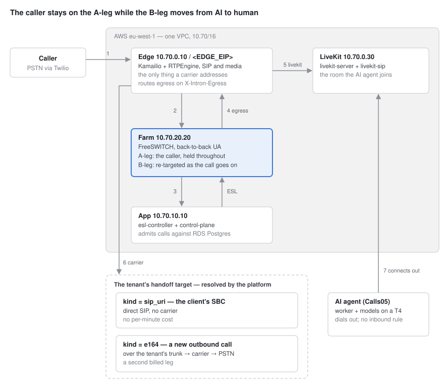

# Intron SIP Platform — Architecture and Integration

Version: v0.0.1

## Overview

A self-hosted SIP platform that puts a phone caller into a LiveKit room with an
AI agent, and can hand the call to a human when the conversation needs one.

This document describes the platform as designed for Phase 1 (see
[ROADMAP.md](ROADMAP.md)): what each component does, the configuration that
matters, and the contract between the SIP side and the AI agent side. §8 lists
the changes needed on the agent worker.

Audience: engineers on either side of that boundary.

### A note on addresses

**Private addresses are stable.** `10.70.0.10`, `10.70.20.20`, `10.70.10.10`
and `10.70.0.30` are pinned in Terraform from the VPC subnet plan, so they
survive a rebuild and are safe to configure against.

**Public addresses are written as `<EDGE_EIP>` and similar.** Elastic IPs are
allocated at apply time; take the current values from Terraform rather than
from this document:

```
cd infra/iac && make output STACK=sip-core ENV=beta EXTRA="-raw edge_public_ips"
```

Both values the AI agent side needs — the LiveKit URL and the transfer
destination — are stable: one is a DNS name, the other a private address.

---

## 1. The call path



Numbers on the arrows match the steps below; 5 and 6 are the two values of
`X-Intron-Egress`.

① A carrier sends an INVITE to the edge's Elastic IP.
② Kamailio dispatches it to a FreeSWITCH node. No admission decision is made here.
③ FreeSWITCH opens a TCP socket to the controller **before answering** and hands it the call. The controller resolves the number against Postgres and decides what happens.
④ Whatever the call bridges to, FreeSWITCH sends that INVITE **back out through Kamailio**, never direct. Kamailio picks the destination from the `X-Intron-Egress` header.
⑤ `livekit` — the AI leg. Dispatcher set 2, straight to livekit-sip.
⑥ `carrier` — a human. Two shapes, and they cost differently; see below.
⑦ The agent worker connects outward to LiveKit and waits to be given work.

**The handoff is a B-leg swap.** The caller never leaves the A-leg: FreeSWITCH
drops the LiveKit leg and dials the handoff target on a fresh B-leg, bridging it
to the same caller. From the caller's side the AI stops talking and a person
starts.

**Why an E.164 handoff goes back out through a carrier.** An E.164 is a number
on the public telephone network, so reaching it means *placing an outbound
call*. That needs a carrier, and the carrier is the tenant's trunk.

It is a **new call to a different number** that happens to use the same trunk
the inbound call arrived on — not the original call returning to its caller.
The platform is briefly paying for two legs: the caller inbound, and the agent's
phone outbound.

A `sip_uri` target avoids this entirely. The call goes straight to the client's
SBC over SIP, with no carrier in the path and nothing billed per minute. Where a
client has an SBC, that is the cheaper and shorter route.

### The one structural fact

**FreeSWITCH is a back-to-back user agent.** It holds the caller on one leg
while independently re-targeting the other. That is what makes "AI first, human
second" possible: the caller stays connected while the far end changes from a
LiveKit room to a contact centre.

### Where the boundary sits

| | Runs on |
|---|---|
| Kamailio, RTPEngine, FreeSWITCH, controller, control-plane, LiveKit | the SIP platform's VPC |
| the agent worker, STT/LLM/TTS models, the GPU | Calls05 |

The agent worker dials *out* to LiveKit. Nothing reaches inward to the GPU box,
so no inbound firewall rule is needed there.

---

## 2. Kamailio — the edge

The only component a carrier ever addresses. It carries SIP and nothing else:
it does not anchor media, does not decide admission, and holds no carrier
credentials.

### Advertised address

The instance has one NIC holding `10.70.0.10`. Its Elastic IP is mapped 1:1 at
the VPC edge and appears nowhere on the box.

```
listen=udp:10.70.0.10:5060 advertise <EDGE_EIP>:5060
listen=tcp:10.70.0.10:5060 advertise <EDGE_EIP>:5060
alias="<EDGE_EIP>"
auto_aliases=no
```

Without `advertise`, Via and Contact carry the private address, the carrier
sends ACK and BYE somewhere unroutable, and channels leak until they time out.
The INVITE succeeds and the call answers, so nothing looks wrong until teardown.

### Carrier allowlist

5060 is open only to Twilio's eight published signalling ranges — **all** of
them, not only the one the trunk is homed in. Twilio's own guidance is to allow
every regional range, because a failover means calls arrive from a different
edge.

### The source-address branch

Two kinds of INVITE arrive, and they are not interchangeable:

```
if (is_method("INVITE")) {
    if (src_ip == 10.70.20.0/24) {   # from the FreeSWITCH farm
        route(EGRESS);
    } else {                          # from a carrier
        route(DISPATCH);
    }
}
```

Without the branch, an egress INVITE would be dispatched back to FreeSWITCH —
the call answers and then dies at bridge, pointing at the wrong layer entirely.

### Dispatcher

| Set | Destination |
|---|---|
| 1 | the FreeSWITCH farm, `sip:10.70.20.20:5060` |
| 2 | livekit-sip, `sip:10.70.0.30:5060` |

Both are OPTIONS-probed every 10s; a node that stops answering is taken out of
rotation. The probe state (`AP` = active, probing) is the first diagnostic when
a leg fails.

Egress chooses between them on a header, not on the shape of the Request-URI —
see [§10](#10-the-integration-contract).

---

## 3. RTPEngine — media

Runs on the edge box alongside Kamailio. Every RTP packet in either direction
crosses it, which is what keeps FreeSWITCH's private addresses out of anything
a carrier sees.

### The interface line

```
interface = private/10.70.0.10!<EDGE_EIP>
```

The `private!public` form is the same problem as Kamailio's `advertise`: the
box cannot discover its own public address. Get it wrong and the rewritten SDP
offers `10.70.x` to a carrier that cannot route there — **the call sets up
perfectly, signalling is clean end to end, and there is no audio in either
direction.**

### Kernel forwarding

```
table = 0            # xt_RTPENGINE kernel module
port-min = 30000
port-max = 40000
listen-ng = 127.0.0.1:2223
```

With the kernel module, RTPEngine installs the mapping once at call setup and
the kernel forwards from then on. Without it the daemon relays every packet
through userspace and the box loses most of its capacity — silently, because
calls keep working. The Ansible role asserts the module is loaded rather than
assuming it.

The ng control port is **UDP**, which matters when writing health checks: a TCP
connect test will time out against a perfectly healthy daemon.

---

## 4. FreeSWITCH — the B2BUA

Deliberately minimal: 19 modules, no conferencing, no voicemail, no XML-RPC. It
exists to own a call and be able to change its mind mid-call.

### Limits

```
max-sessions         2000     # a call is TWO channels: A-leg + B-leg
sessions-per-second  100
codecs               PCMU, PCMA, OPUS, G722
rtp ports            16384-32768
```

1000 concurrent calls is exactly 2000 channels, so the ceiling is a cliff
rather than a slope.

### The dialplan

```xml
<action application="set" data="hangup_after_bridge=true"/>
<action application="set" data="continue_on_fail=false"/>
<action application="set" data="intron_node=beta-freeswitch-1"/>

<action application="export"
        data="nolocal:sip_route_uri=sip:10.70.0.10:5060"/>

<action application="socket" data="esl.beta.intron.internal:8022 async full"/>
<action application="log"    data="ERR controller returned without handling call"/>
<action application="hangup" data="NORMAL_TEMPORARY_FAILURE"/>
```

**It does not answer.** The call is handed over pre-answer so the controller
owns answer-versus-reject. Answering first would start carrier billing on a
call that may turn out to be unroutable, and would make a rejection sound to
the caller like a call that connected and then died.

**`sip_route_uri` is the egress mechanism.** It forces the next hop to Kamailio
while the Request-URI still names the real destination. Without it a bridged
leg goes straight at the carrier from the NAT gateway's address, which is not
in Twilio's Termination IP ACL — a 403, or worse, silence.

`nolocal:` puts the variable on the outbound leg only.

### Recording

Recording is done **by FreeSWITCH, on the A-leg**, not by LiveKit egress.

```
/mnt/recordings     dedicated EBS volume, mounted by volume-ID not device path
format              wav
```

The reason is handoff. LiveKit egress records *the room*; when a call is handed
to a human the caller leaves the room, so egress captures the bot conversation
and stops exactly when a person takes over. Recording the A-leg at FreeSWITCH
can cover the whole call, bot and human alike, and survives the agent failing
to join at all.

### Three modes, set per line

`traffic_configs.recording_mode`:

| Mode | Behaviour |
|---|---|
| `none` | no recording. The default — recording clinical audio is a decision someone makes, not one they inherit |
| `ai_only` | record the AI conversation; **stop when a human takes over** |
| `full` | record the whole call, handoff included |

`ai_only` exists because the two halves of a call are not the same question. A
caller consented to speak to a bot; whether the human conversation that follows
may be recorded differs per client — some contact centres record their own side
and forbid a second copy, some operate under two-party consent where the agent
has not agreed, and for clinical audio the human half is often the more
sensitive one.

**The mode is fixed when the call starts.** It is snapshotted onto the call
rather than re-read at handoff, so an operator editing a line mid-call cannot
change the recording policy of a conversation already in progress.

**`ai_only` has to stop the recording, not merely not start one.** The
recording is a media bug on the caller's channel, and a transfer moves that
same channel back into the dialplan, so the bug goes with it. The transferred
leg therefore issues `stop_record_session` before bridging the human. A line
whose destination is `handoff` from the start has no AI half, so under
`ai_only` it records nothing at all.

---

## 5. ESL controller

The only service that talks to FreeSWITCH, in both directions. Five concurrent
components:

| Component | Does |
|---|---|
| **listener** `:8022` | accepts FreeSWITCH's per-call socket, holds it for the life of the call |
| **ESL pool** → `:8021` | one outbound connection per FreeSWITCH node, for commands and events |
| **originate worker** | claims queued outbound calls and places them |
| **sweeper** | reclaims concurrency slots held by a controller that died |
| **health** `:8089` | checks Postgres and the ESL pool |

### Per call, on the listener

1. Resolve the dialled number against Postgres — trunk, line, tenant, is the tenant suspended, is it over its cap
2. Claim a concurrency slot
3. Answer, or reject with a cause code
4. Bridge: to LiveKit, or to a handoff target
5. Subscribe to channel events and track the call
6. On hangup, write the CDR and release the slot

**Admission happens in-process, against the database, with the call already in
hand.** There is no HTTP call anywhere in the call path. That is why the
control-plane API can restart mid-call without dropping anything, and why a
database blip costs one call's decision rather than closing the door on every
inbound call.

### Outbound

Only this service holds ESL connections, so the API cannot dial. The handoff is
a database row:

```
POST /v1/originate → find the from-number's outbound line → claim slot → INSERT originate_requests → 202
                                                      │
controller polls 250ms, claims with FOR UPDATE SKIP LOCKED, drains the queue
                                                      │
                                    bgapi originate … sofia/internal/sip:<to>@<trunk>
```

`SKIP LOCKED` is the whole concurrency mechanism: two controllers polling in the
same instant get different rows and neither blocks. Without it the second would
block, then claim the same row after commit — ringing a customer twice.

The from-number decides everything: it must sit inside an **active outbound
line** belonging to the tenant, and that line supplies the trunk, what the
answered customer is connected to, and the recording mode — snapshotted onto
the slot at queue time, because that is when the call starts.

`bgapi`, not `api`: a synchronous originate would hold the one ESL connection
for the whole ring and block everything behind it.

The row is also the audit trail — who asked, when, what happened, why it failed
— and it survives a controller restart where an in-flight HTTP request would
not.

---

## 6. Control plane — resources and endpoints

REST over Postgres. Configuration and read models only; **nothing here is in the
path of a call.**

### The model

```
tenants            id, name, status, concurrency_cap

trunks             a carrier connection AND the numbers it carries
                   tenant_id NULL  = platform trunk
                   tenant_id set   = the client's own (BYOT)
                   sip_host, sip_port, sip_auth_method
                     (ip_whitelisting | registration)
                   signalling_cidrs[], media_cidrs[]
                   did_ranges        the inventory

traffic_configs    what happens to a subset of those numbers — one LINE
                   tenant_id  (on the platform trunk, who the numbers are leased to)
                   trunk_id, direction (inbound | outbound)
                   did_ranges        typically a subset of the trunk's
                   destination       ai | handoff | reject
                   recording_mode    none | ai_only | full

handoff_targets    tenant_id (default list)
                   traffic_config_id (optional per-line override)
                   kind (sip_uri | e164), destination, priority
```

The combination is the point. Each line independently chooses **their trunk or
ours**, **AI or human**, **inbound or outbound**, and **what is recorded**:

| Line | Trunk | Numbers | Direction | Does | Records |
|---|---|---|---|---|---|
| Main | ours (Twilio) | +234…100–199 | inbound | AI | `ai_only` |
| Support | their SBC | +234…500–509 | inbound | handoff | `none` |
| Campaign | ours | +234…100–199 | outbound | AI | `full` |

Nothing couples those choices. A client can bring their own trunk and use our
bot, or use our trunk and escalate to their own contact centre, and record
either, neither, or only the part a machine was talking.

### Rules the database enforces

Each of these would otherwise route a real caller to the wrong place, and each
is a race if left to application code. A request that breaks one gets **409**
with a message saying which.

| Rule | Why |
|---|---|
| A number is on **one trunk** only | an INVITE carries nothing saying which carrier sent it, so the number alone must identify the trunk |
| No two lines claim a number **in the same direction** | one number, one answer when it rings |
| A line's numbers lie **within its trunk's** | otherwise it admits calls no carrier delivers |
| A line on a client's trunk belongs to **that client** | otherwise one tenant routes calls over another's carrier account |
| A trunk cannot shrink or be deleted **under a line** | same reason, from the other side |
| A handoff override belongs to **the line's tenant** | otherwise one tenant's human takes another's calls |

**An E.164 handoff leaves by the call's own trunk** — the one its line's numbers
live on — read from the call, not looked up from the tenant. A tenant on the
platform trunk has no trunk of its own, and this is what lets it hand off to a
phone number at all.

### Endpoints

| | |
|---|---|
| `GET POST /v1/tenants` · `PATCH DELETE /{id}` | |
| `GET POST /v1/trunks` · `PATCH DELETE /{id}` | |
| `GET POST /v1/traffic-configs` · `PATCH DELETE /{id}` | lines; numbers as inclusive E.164 `{from, to}` blocks |
| `GET /v1/numbers/{e164}` | which trunk carries a number, and which line handles it each way |
| `GET POST /v1/handoff-targets` · `PATCH DELETE /{id}` | |
| `POST /v1/originate` · `GET /v1/originate/{call_uuid}` | queue an outbound call |
| `GET /v1/calls` · `GET /v1/call-history` | live calls, CDRs |
| `GET /v1/route?did=&from=` | "would this call be admitted, and why not" — same code the call path uses |
| `GET /v1/trunks/{id}/coverage` | how a trunk's numbers divide among lines, and which are uncovered |
| `GET POST /v1/api-keys` · `DELETE /{id}` | |
| `GET /openapi.json` · `GET /docs` | unauthenticated |

Auth is bearer API keys, hashed at rest, scoped `read` / `write` / `admin`.
Creating a tenant requires a platform key — a tenant-scoped key doing it would
be privilege escalation.

---

## 7. LiveKit — the SIP platform side

One box, four containers on the host network, one systemd unit.

| Container | Role |
|---|---|
| `redis` | LiveKit state |
| `livekit` | the media server; rooms live here |
| `caddy` | TLS for `livekit-beta.intron.quiverlearn.com` |
| `sip` | livekit-sip — turns a phone call into a room participant |

```
sip_port          5060
rtp_port          10000-20000
ws_url            ws://localhost:7880     # loopback, same host
use_external_ip   false                   # in-VPC only
```

`sip.yaml` ships as a template; the API key and secret are substituted from
Secrets Manager at service start, so no credential is written by Ansible or
stored in the repo.

### Provisioning

A script runs once and creates two objects inside LiveKit, idempotently:

**An inbound trunk** —
```json
{ "name": "intron-sip-inbound",
  "allowed_addresses": ["10.70.0.10/32"] }
```

**A dispatch rule** —
```json
{ "name": "intron-sip-inbound",
  "trunk_ids": ["ST_…"],
  "rule": { "dispatch_rule_individual": {
      "room_prefix": "intron_sip_", "no_randomness": true } },
  "room_config": { "agents": [{ "agent_name": "intron_convobot_agent_2" }] } }
```

The dispatch rule is what summons the agent: LiveKit sees the rule names an
agent and gives the job to whichever worker has registered under that name.

### Two independent locks

Who may present a call to livekit-sip is restricted twice — by the security
group on port 5060, and by `allowed_addresses` on the trunk. They are written
against different things and fail independently.

### Transport

Plain UDP, no TLS, no SRTP. Correct because this leg no longer crosses the
public internet — LiveKit sits in the same VPC, reached over private addresses,
with its SIP port open only to the edge's security group.

---

## 8. AI agent — required changes

The agent worker runs on Calls05 and connects outward to LiveKit. It needs five
configuration values and one code change to work against this platform.

### Configuration — `service_convo_bot/.env`

| Variable | Current | Required | Why |
|---|---|---|---|
| `LIVEKIT_URL` | the existing LiveKit server | `wss://livekit-beta.intron.quiverlearn.com` | which server the worker registers with |
| `LIVEKIT_API_KEY` | — | *(provided separately)* | |
| `LIVEKIT_API_SECRET` | — | *(provided separately)* | |
| `CONVOBOT_SIP_TRANSFER_DIRECTIONS` | `OUTBOUND` | `INBOUND,OUTBOUND` | **blocks every handoff** on inbound calls today |
| `CONVOBOT_SIP_TRANSFER_TO` | empty | `sip:handoff@10.70.0.10` | a reserved word, not a number — see below |
| `CONVOBOT_LIVEKIT_WORKER_NUM_IDLE_PROCESSES` | `2` on the unit | ≥ `1` — **already satisfied**, keep it | with `0`, an inbound caller waits ~80s for models to load |

**On transfer:** with the current values the agent says "please hold while I
transfer you", calls its own `manage_call` tool, receives *"SIP transfer is not
enabled for INBOUND calls"*, and apologises to the caller. No REFER is ever
sent. The mechanism is already built and simply switched off for this direction.

**On the destination:** `sip:handoff@10.70.0.10` is a reserved word meaning
*that* a transfer is wanted. Where it goes is resolved from the tenant's
configured handoff targets when the call re-enters the platform. An agent that
named a phone number directly would be choosing a destination the tenant has
not authorised.

The host must be the edge's **private** address: the edge admits the FreeSWITCH
farm by security-group reference, which only matches a private source.

### Code change — required

**`service_convo_bot/service_convobot_libs_worker_agent_livekit.py:1228`**

```python
res = await lkapi.egress.start_room_composite_egress(req)
```

Called unconditionally on every call, before `ctx.connect()`. This platform runs
no egress service — recording is done by FreeSWITCH on the A-leg, which also
covers the portion of a call after a human takes over, where room-composite
egress would have stopped.

With no egress worker, livekit-server waits for one to answer over Redis and
takes about **23 seconds** to return 503. Observed:

```
16:17:10  entrypoint starts
16:17:33  egress fails              ← 23s of silence
16:17:38  GREETING_WAIT_TIMEOUT: no participant_connected in 5s
```

The caller sits in a silent room and hangs up. The existing `except` block
already treats the failure as non-fatal — the problem is purely the wait, which
outlasts the agent's own greeting timeout.

**Requested:** gate the call behind a config flag, defaulting to enabled so
current behaviour is unchanged.

```python
if APP_CONFIG.ENABLE_SESSION_RECORDING:
    res = await lkapi.egress.start_room_composite_egress(req)
```

### Code change — optional

**Line 336**

```python
split_romm_prefix_and_phone = str(room_name).split("__")
```

The caller's number is parsed out of the room name. This affects the log prefix
and the timezone used when scheduling a callback; it does not affect call
handling, because the transfer path returns the single SIP participant without
consulting it.

livekit-sip sets `sip.phoneNumber` on the SIP participant, and this code already
reads that attribute elsewhere (line 862). Preferring it over the string split
would remove a contract between this parser and the platform's room-naming
configuration — one that fails silently, since the agent still answers.

---

## 9. Test PBX

A disposable Asterisk instance standing in for a client's contact centre, so the
handoff leg can be exercised before a real SBC exists.

```
sip:agent@<TEST_PBX_EIP>        the handoff target
```

A softphone registers to it as `agent` and answers transferred calls. It is
reached over the **public** internet even though it sits in the same VPC: the
security group admits the edge's Elastic IP rather than referencing its security
group, which forces the traffic out through the internet gateway and back. A
test target on a private address would not exercise the address rewriting that a
real SBC exposes.

Registration is over **TCP**. UDP 5060 is dropped by the operator's network — a
packet capture on the instance recorded other UDP traffic while three probes
from the operator's machine produced zero packets. This affects the softphone
only; the handoff leg from the edge is UDP.

Nothing depends on this stack and it carries no `prevent_destroy`. It is removed
when a real SBC is available.

---

## 10. The integration contract

The things that span the boundary, and that fail quietly when they disagree.

### SIP headers set by FreeSWITCH on egress

| Header | Values | Read by |
|---|---|---|
| `X-Intron-Egress` | `carrier` \| `livekit` | Kamailio's `route[EGRESS]` |
| `X-Intron-Tenant` | tenant id | available to the agent |
| `X-Intron-Room` | room name | |
| `X-Intron-DID` | the dialled number | |

Kamailio branches on the header rather than inferring intent from the
Request-URI. Inference works until a handoff target is a bare E.164 that looks
exactly like a carrier destination — at which point a call meant for a contact
centre is dispatched to LiveKit, and the caller is answered by an AI agent they
did not ask for.

### The transfer word

```
CONVOBOT_SIP_TRANSFER_TO = sip:handoff@10.70.0.10
```

Reserved. It says *that* a transfer is wanted; the destination is resolved from
the tenant's handoff targets when the call re-enters the dialplan.

### Room naming

```
intron_sip_<something>__<caller number>
```

The `__` separator is a contract between the platform's room prefix and the
agent's parser. Fixing this is the optional change in [§8](#code-change--optional).

### Credentials

| What | Direction |
|---|---|
| LiveKit URL, API key, API secret | platform → agent side |
| agent name `intron_convobot_agent_2` | agent side → platform (used in the dispatch rule) |

Two values of the same credential exist in different places with nothing keeping
them in step. Rotating the LiveKit API key means updating Secrets Manager **and**
the agent's `.env`.

---

## 11. Current sizing and cost

Beta is deliberately one of everything. No tier is redundant, and a restart of
any of them is an outage for the calls it is carrying.

| Component | Instance | Notes |
|---|---|---|
| Edge — Kamailio + RTPEngine | `c6i.large` | holds the platform's Elastic IP |
| Farm — FreeSWITCH | `c6i.xlarge` | + EBS volume for recordings |
| App — controller + control-plane | `m6i.large` | both containers, `--network host` |
| LiveKit | `t3.small` | 4 containers; own Elastic IP |
| Database | `db.t4g.micro` | Postgres 16, 20 GB gp3, autoscaling to 100 GB, single-AZ |
| Test PBX | `t3.micro` | disposable |

**Roughly $400/month**, plus the NAT gateway and data transfer. The test PBX
adds about $8 and is removed when a real SBC is available.

The GPU running the models is not part of this and is not costed here.

### Known limits at this size

- **`max-sessions 2000`** on FreeSWITCH — a call is two channels, so this caps
  concurrency at 1000 before anything else does.
- **`t3` instances are burstable.** Sustained CPU above the baseline depletes
  credits and the instance is throttled rather than degrading gracefully. Fine
  for bursts; not for sustained load.
- **`livekit_count == 1`** is enforced by a Terraform validation rule. Going
  multi-node is a deliberate change, not a variable bump.
- **Single-AZ Postgres.** A blip costs the calls arriving during it — admission
  happens per call in the controller, so the blast radius is one call at a time
  rather than the whole platform.

Every tier except the edge scales horizontally: Kamailio's dispatcher already
round-robins the FreeSWITCH farm and probes it with OPTIONS, and LiveKit
supports multi-node with Redis. The edge is pinned by its Elastic IP, which
carriers address directly.
